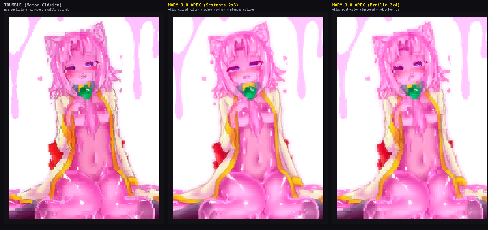
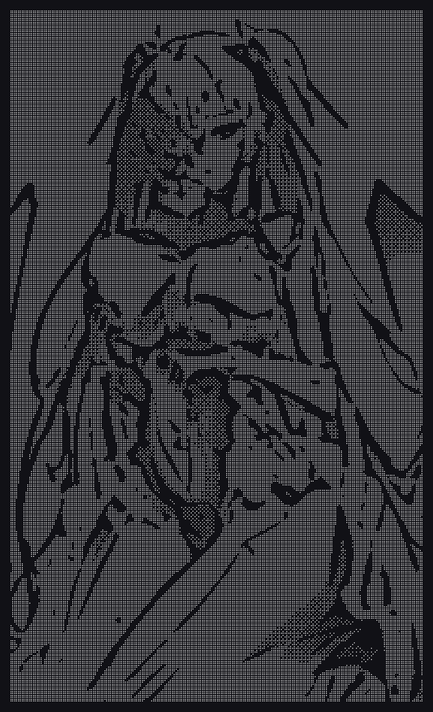
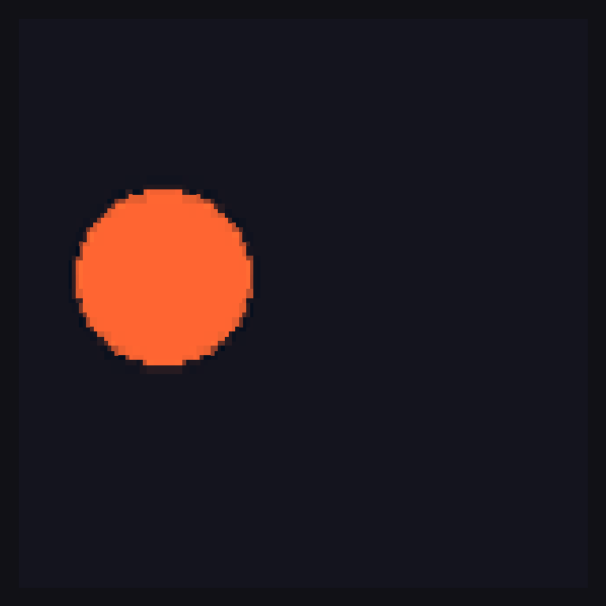
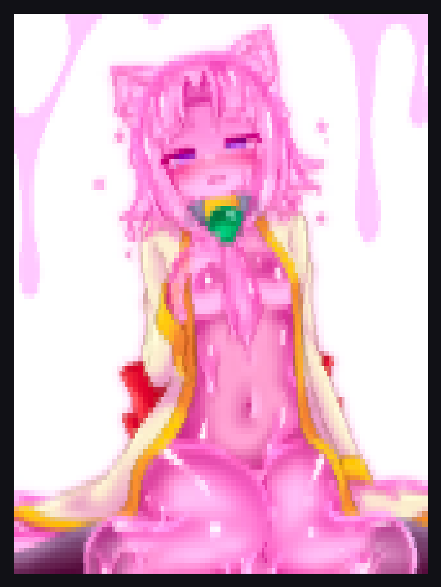

# 🔧 Lumart (Luma) v2.5.0 Master Walkthrough, Technical Manual & Troubleshooting Guide

[English (Default)](TROUBLESHOOTING.md) | [Español](TROUBLESHOOTING.es.md) | [Português](TROUBLESHOOTING.pt.md) | [Français](TROUBLESHOOTING.fr.md) | [Deutsch](TROUBLESHOOTING.de.md) | [Русский](TROUBLESHOOTING.ru.md) | [日本語](TROUBLESHOOTING.ja.md) | [한국어](TROUBLESHOOTING.ko.md)

> **The definitive master guide for Lumart (Luma)**: Architectural foundations, four flagship rendering engines, dedicated CLI subcommands, complete flag encyclopedia, practical recipes, and exhaustive troubleshooting manual.

---
> [!NOTE]
> 📖 **Unified Master Guide Available**: This troubleshooting guide has been unified with the complete CLI walkthrough into our Master Manual, available in all 8 supported languages:
> * 🇬🇧 [English Master Manual (WALKTHROUGH.md)](WALKTHROUGH.md)
> * 🇪🇸 [Manual Maestro en Español (WALKTHROUGH.es.md)](WALKTHROUGH.es.md)
> * 🇫🇷 [Manuel Maître en Français (WALKTHROUGH.fr.md)](WALKTHROUGH.fr.md)
> * 🇩🇪 [Master-Handbuch auf Deutsch (WALKTHROUGH.de.md)](WALKTHROUGH.de.md)
> * 🇧🇷 [Manual Mestre em Português (WALKTHROUGH.pt.md)](WALKTHROUGH.pt.md)
> * 🇷🇺 [Полное Руководство на Русском (WALKTHROUGH.ru.md)](WALKTHROUGH.ru.md)
> * 🇯🇵 [日本語完全マスターマニュアル (WALKTHROUGH.ja.md)](WALKTHROUGH.ja.md)
> * 🇰🇷 [한국어 마스터 매뉴얼 (WALKTHROUGH.ko.md)](WALKTHROUGH.ko.md)

Welcome to the definitive troubleshooting, architectural reference, and operational manual for **Luma** (and `lumart`). This guide provides in-depth solutions to common issues, terminal emulator compatibility benchmarks, native C++ compilation guides, rendering engine mechanics, localization configuration, and internal architectural details.

---

## 📑 Table of Contents
1. [Quick Diagnostic Checklist](#1-quick-diagnostic-checklist)
   - [1.1 Visual "Dos & Don'ts" Master Guide](#11-visual-dos--donts-master-guide-lo-que-se-debe-y-no-se-debe-hacer)
2. [Installation & Native C++ Dependency Resolution](#2-installation--native-c-dependency-resolution)
3. [Terminal Emulators & Font Compatibility](#3-terminal-emulators--font-compatibility)
4. [Color Fidelity & TrueColor (24-bit ANSI)](#4-color-fidelity--truecolor-24-bit-ansi)
5. [The Four Flagship Rendering Engines (Deep Dive & Architecture)](#5-the-four-flagship-rendering-engines)
   - [5.1 Mary Apex 3.5 (Perceptual Oklab & Subpixel Micro-Blocks)](#51-mary-apex-35-perceptual-oklab--subpixel-micro-blocks)
   - [5.2 Trumble Orelx 2.2 (Retro-Arcade Cel-Shading & Anime Ink)](#52-trumble-orelx-22-retro-arcade-cel-shading--anime-ink)
   - [5.3 Luris Mono 2.6 (Monochrome Manga Screentone & Transparent Stickers)](#53-luris-mono-26-monochrome-manga-screentone--stickers)
   - [5.4 Spectra Weep 2.0 (Real-Time Live Video, Webcam & 12 Shaders)](#54-spectra-weep-20-real-time-live-video-webcam--12-shaders)
6. [Specialized Subcommands & Built-in Tools](#6-specialized-subcommands--built-in-tools)
   - [6.1 lumart fetch (Fastfetch / Neofetch Preset Generator)](#61-lumart-fetch-fastfetch--neofetch-preset-generator)
   - [6.2 lumart bench (Multi-Core Performance & Latency Benchmark)](#62-lumart-bench-multi-core-performance--latency-benchmark)
   - [6.3 lumart showcase (4-in-1 Comparison Canvas)](#63-lumart-showcase-4-in-1-comparison-canvas)
   - [6.4 lumart info (Visual Image Inspector & Engine Recommender)](#64-lumart-info-visual-image-inspector--engine-recommender)
   - [6.5 lumart diff (Chromatic Delta Heatmap Between Two Images)](#65-lumart-diff-chromatic-delta-heatmap-between-two-images)
   - [6.6 lumart slideshow (Full-Screen Terminal Presentation)](#66-lumart-slideshow-full-screen-terminal-presentation)
   - [6.7 lumart -I / --interactive (Interactive TUI Viewer)](#67-lumart--i----interactive-interactive-tui-viewer)
   - [6.8 lumart animate (GIF Transcoder & Video Compiler)](#68-lumart-animate-gif-transcoder--video-compiler)
7. [Sizing, Aspect Ratio & Character Font Calibration](#7-sizing-aspect-ratio--character-font-calibration)
8. [High-Definition Graphic Image & Sticker Export (`-o`, `--loop`, `--preload`)](#8-high-definition-graphic-image--sticker-export--o---loop---preload)
9. [Configuration, Persistence & Localization (i18n)](#9-configuration-persistence--localization-i18n)
10. [Command History & Interactive Replay System (`-H`, `-R`)](#10-command-history--interactive-replay-system--h--r)
11. [Updates, Upgrades & Rollback System (`-u`, `-uu`, `-dg`)](#11-updates-upgrades--rollback-system--u--uu--dg)
12. [Linux Desktop & File Manager Integration (`--install-desktop`)](#12-linux-desktop--file-manager-integration---install-desktop)
13. [Real-World Practical Recipes & Workflows](#13-real-world-practical-recipes--workflows)
14. [Complete CLI Encyclopedia of Flags & Options](#14-complete-cli-encyclopedia-of-flags--options)
15. [Master Command Reference & Cheat Sheet](#15-master-command-reference--cheat-sheet)

---

## 1. Quick Diagnostic Checklist

If an image looks distorted, pixelated, fails to render, or displays unexpected output, consult this quick reference:

| Symptom | Primary Cause | Immediate Resolution |
| :--- | :--- | :--- |
| `command not found: luma` or `lumart` | `~/.local/bin` is missing from `$PATH` | Run `./install.sh` or add `export PATH="$HOME/.local/bin:$PATH"` to `~/.bashrc` / `~/.zshrc`. |
| `error: externally-managed-environment` | PEP 668 restriction on Fedora, Debian, or Ubuntu | Install native system packages: `sudo dnf install python3-pillow` / `sudo apt install python3-pil`, or run `./install.sh`. |
| Braille dots or blocks look like `?`, ``, or empty boxes | Active terminal font lacks Unicode glyph coverage | Switch to a Nerd Font (JetBrains Mono Nerd Font, Fira Code, Cascadia Code). |
| Horizontal black gaps cutting through Braille characters | Terminal emulator line-height / row spacing is greater than `1.0` | Set terminal line-height / padding offset to `1.0` or `0px` in terminal config. |
| Washed-out colors or harsh 16-color banding | Terminal emulator does not advertise or support 24-bit TrueColor | Verify `$COLORTERM` (`echo $COLORTERM`) or switch to Ghostty, Kitty, Alacritty, or WezTerm. |
| Output wraps around lines and looks shredded | Specified render width (`-w`) exceeds terminal columns | Reduce width with `-w 90` or dynamically fit with `-w $(tput cols)`. |
| Braille or Monochrome output looks like an inverted photographic negative | Terminal background is light (white/cream) instead of dark | Luris Mono auto-detects white backgrounds and inverts automatically. For manual override: add `-i` / `--invert`. |
| Mary or Luris running on Python fallback instead of C++ | C++ shared libraries (`libmary.so`, `libmonochrome.so`) not compiled | Install `g++` (`build-essential` / `gcc-c++`) and run `make -f Makefile.native` or `./install.sh`. |
| `OpenCV required for Spectra engine` error | `opencv-python` is not installed | Install via your system package manager (`python3-opencv`) or `pip install opencv-python`. |
| Web camera fails to open in Spectra mode (`-W` or `-E spectra`) | Missing camera permissions or incorrect `/dev/video*` index | Add user to video group: `sudo usermod -aG video $USER`, or specify camera index: `lumart -W 1` or `lumart -E spectra`. |
| Output vertically stretched or squashed | Terminal font has atypical aspect ratio (not 1:2) | Calibrate with `--font-ratio <float>` (e.g., `--font-ratio 0.45` or `0.55`). Default is `0.5`. |
| Prefer monochrome or light terminal background | Color codes enabled by default or light background | Pass `--no-color` or `NO_COLOR=1`. For light themes, invert with `-i`. Force color back with `-c`. |
| Want explicit engine control instead of auto-routing | Preference for deterministic engine selection | Use `-E <engine>` (e.g. `-E mary`, `-E trumble`, `-E luris`, `-E spectra`). |
| Prefer progressive scan animation over instant output | Output renders all at once by default | Pass `--reveal` for line-by-line progressive animation. Pass `--instant` for immediate display. |
| Transparent sticker output (`--transparent`) has black background | Transparent alpha is only supported in Luris Mono engine with `.png` | Run `lumart image.png -m --transparent -o sticker.png`. Color models export with solid terminal background. |
| WebP export rejected with error | WebP export was permanently disabled to protect visual quality | Export to `.png` or `.jpg` instead (`-o output.png`). |
| Language remains Spanish or English despite system locale | Locale environment variable not recognized or overridden by config | Set language explicitly: `lumart --lang <code>` (e.g., `lumart --lang fr` for French). |

---

## 1.1 Visual "Dos & Don'ts" Master Guide (Lo que se DEBE y NO se debe hacer)

To guarantee the highest visual fidelity and prevent user errors, follow these architectural principles:

### 1. Engine Choice & Visual Character: Photorealism vs Anime vs Manga



| Aspect | ✅ What to DO (Lo que se DEBE hacer) | ❌ What NOT to do (Lo que NO se debe hacer) |
| :--- | :--- | :--- |
| **Photorealistic & TrueColor** | **DO** use default **Mary Apex 3.5** (`lumart photo.jpg`) for portraits, natural skin tones, and rich real-world scenes. It uses perceptual Oklab color space ($\Delta E$) with 2x3 Sextants micro-blocks. | **DON'T** force `--blocks` or `--boost` on delicate photographs or skin tones unless you explicitly want a saturated retro-arcade look. |
| **Retro Arcade & Cel-Shading** | **DO** use **Trumble Orelx 2.2** (`lumart art.png -E trumble`) with `--boost` for Capcom CPS-2 / Neo-Geo style vibrant posters. | **DON'T** expect Trumble to produce smooth gradients; Trumble is designed for sharp comic edges and saturated posterized bands. |
| **Japanese Manga & Line Art** | **DO** use **Luris Mono 2.6** (`lumart manga.jpg -m`) to recreate authentic physical comic screentones (*Ami-tone*) and DoG ink contour lines. | **DON'T** use general ASCII tools that randomly scramble letters; Luris uses calibrated Bayer matrices and Atkinson error diffusion. |

---

### 2. Viewport Auto-Fitting (`-F`) vs Manual Width (`-w`)

| Principle | ✅ What to DO (Lo que se DEBE hacer) | ❌ What NOT to do (Lo que NO se debe hacer) |
| :--- | :--- | :--- |
| **Interactive Terminal Viewing** | **DO** use `-F` (`--fit`) to let Lumart calculate both width and height to fit your exact terminal window without vertical scrolling or line wrapping:<br>`lumart artwork.jpg -F` | **DON'T** combine `-F` and `-w` simultaneously:<br>`lumart artwork.jpg -F -w 80` ❌<br>*Lumart will halt with code 2 explaining that `--fit` dynamic calculation conflicts with fixed `--width`.* |
| **Fixed Pipelining or Fetch** | **DO** use `-w <columns>` when embedding into a fixed-width fetch screen, Neofetch sidebar, or CLI dashboard. Combine with `--fastfetch` to auto-crop whitespace. | **DON'T** set `-w` wider than your terminal emulator columns, which forces lines to wrap and distorts characters. |

---

### 3. Transparent Stickers & Alpha Transparency Policy

| Mary Apex 3.5 (Solid Canvas) | Luris Mono 2.6 (Transparent Sticker) |
| :---: | :---: |
| <br><sub>**DO**: Export color art on solid dark canvas</sub> | <br><sub>**DO**: Export manga stickers with `--transparent -o .png`</sub> |

| Principle | ✅ What to DO (Lo que se DEBE hacer) | ❌ What NOT to do (Lo que NO se debe hacer) |
| :--- | :--- | :--- |
| **Transparent PNG Stickers** | **DO** use `--transparent` exclusively with **Luris Mono** (`-m`, `-s`, `-d`) and export to `.png`:<br>`lumart character.png -m --transparent -o sticker.png`<br>Produces authentic transparent manga cutouts (>90% alpha transparency) perfect for Telegram, Discord, and Slack stickers. | **DON'T** use `--transparent` with `-o output.jpg`. JPEG format does not support alpha channels; Lumart will reject this with `[Lumart Error]`. |
| **Full Color TrueColor Artwork** | **DO** export color artwork on its native high-contrast dark terminal canvas (`#111116`):<br>`lumart photo.png -o photo_art.png`<br>This preserves perceptual contrast and prevents color text from looking washed out outside a terminal. | **DON'T** expect color engines (Mary/Trumble) to cut out backgrounds transparently; terminal text colors require the dark backing canvas for proper luminance contrast. |

---

### 4. Multi-Frame Animations & GIF Export (`--loop`)



| Principle | ✅ What to DO (Lo que se DEBE hacer) | ❌ What NOT to do (Lo que NO se debe hacer) |
| :--- | :--- | :--- |
| **Live Terminal Playback** | **DO** run `lumart animation.gif --loop` for interactive 60 FPS playback in your terminal window. Lumart pre-renders and caches each ANSI frame for stutter-free looping. Press `Ctrl+C` to cleanly exit and restore the terminal cursor. | **DON'T** run `--loop` on single-frame static images expecting animation; Lumart will simply render the single frame. |
| **Animated GIF Compilation** | **DO** export full rendered animations by providing `-o anim.gif` or `--save anim.gif`:<br>`lumart anim.gif --loop -o output.gif`<br>Lumart iterates through all frames, rasterizes each with subpixel accuracy, and compiles an animated GIF. | **DON'T** specify a static extension when using `--loop`:<br>`lumart anim.gif --loop -o anim.png` ❌<br>*Lumart will halt with code 2 explaining that animations cannot be saved to single-frame static images.* |

---

### 5. Light vs Dark Terminal Themes & Automatic Inversion

| Principle | ✅ What to DO (Lo que se DEBE hacer) | ❌ What NOT to do (Lo que NO se debe hacer) |
| :--- | :--- | :--- |
| **Light-Themed Terminals** | **DO** pass `-i` (`--invert`) when using light terminal backgrounds (Solarized Light, PaperColor). In Luris Mono (`-m`), Lumart automatically inspects image borders and auto-inverts when white backgrounds are detected. | **DON'T** leave monochrome or Braille output un-inverted on white terminals, or the image will display inverted like an X-ray negative. |

---

### 6. Subpixel Glyph Selection (Mutually Exclusive Textures)

| Sextants 2x3 (`-S`) | Braille 2x4 (`-B`) | Quadrants 2x2 (`-Q`) |
| :---: | :---: | :---: |
| <br><sub>Micro-blocks (Default)</sub> | <br><sub>Fine Dots & Curves</sub> | <br><sub>Pixel-Art Blocks</sub> |

| Principle | ✅ What to DO (Lo que se DEBE hacer) | ❌ What NOT to do (Lo que NO se debe hacer) |
| :--- | :--- | :--- |
| **Choosing Texture Modes** | **DO** pick the single texture glyph style that matches your aesthetic preference:<br>• `-S` (Sextants): Smooth micro-blocks, continuous gradients.<br>• `-B` (Braille): Fine dot matrix, portraits, stippling.<br>• `-Q` (Quadrants): Dense 2x2 pixel blocks.<br>• `--blocks`: Retro console half-blocks (`▀`/`▄`). | **DON'T** provide multiple texture flags in the same command:<br>`lumart photo.jpg -S -B -Q` ❌<br>*Lumart will immediately halt with code 2 explaining that texture flags are mutually exclusive.* |

---

### 7. Terminal Fonts & Typography Tuning

| Principle | ✅ What to DO (Lo que se DEBE hacer) | ❌ What NOT to do (Lo que NO se debe hacer) |
| :--- | :--- | :--- |
| **Font Choice & Spacing** | **DO** use a modern Unicode monospace font (JetBrains Mono Nerd Font, Fira Code, Cascadia Code) and set your terminal emulator's line-height / row spacing to `1.0` (or `0px`). | **DON'T** use terminal line spacing greater than `1.0` (e.g. `1.2` or `1.5`), as this introduces horizontal gap cuts through Braille and Sextant characters. |

---

## 2. Installation & Native C++ Dependency Resolution

Luma utilizes a hybrid architecture: high-level CLI management, color grading, and terminal formatting in Python 3, paired with ultra-optimized, multi-threaded C++17 shared libraries (`libmary.so`, `libmonochrome.so`) for computationally intensive perceptual algorithms.

### 2.1 The Universal Plug & Play Installer
Run the automated installer from the cloned repository:
```bash
./install.sh
```
Or execute directly from GitHub:
```bash
curl -fsSL https://raw.githubusercontent.com/SilentBlox01/Luma/main/install.sh | bash
```

### 2.2 Native C++17 Compiler Setup
To achieve sub-10 millisecond rendering times on 4K/8K images, Luma compiles native C++ modules. Install a C++17 capable compiler before installation:

- **Ubuntu / Debian / Linux Mint / Pop!_OS**:
  ```bash
  sudo apt update && sudo apt install -y build-essential g++ libgomp1 python3-pil
  ```
- **Fedora / RHEL / Rocky Linux / AlmaLinux**:
  ```bash
  sudo dnf install -y gcc-c++ make libgomp python3-pillow
  ```
- **Arch Linux / Manjaro / EndeavourOS**:
  ```bash
  sudo pacman -S --noconfirm base-devel gcc python-pillow
  ```
- **openSUSE**:
  ```bash
  sudo zypper install -y gcc-c++ make python3-Pillow
  ```
- **macOS (Apple Silicon & Intel)**:
  ```bash
  xcode-select --install
  brew install libomp pillow
  ```

### 2.3 Compiling Native Acceleration Libraries Manually
If you are developing or compiling binaries manually from source:

#### 1. Mary Apex 3.5 Native Engine (`libmary.so` & `luma-mary`):
```bash
# Shared library (loaded automatically by Python via ctypes):
g++ -O3 -std=c++17 -fPIC -shared -fopenmp mary.cpp -o libmary.so

# Standalone CLI binary:
g++ -O3 -std=c++17 -fopenmp mary.cpp -o luma-mary
```

#### 2. Luris Mono 2.6 Native Engine (`libmonochrome.so` & `luma-mono`):
```bash
# Shared library:
g++ -O3 -std=c++17 -fPIC -shared monochrome.cpp -o libmonochrome.so

# Standalone CLI binary:
g++ -O3 -std=c++17 monochrome.cpp -o luma-mono
```

> [!NOTE]
> Both `mary.cpp` and `monochrome.cpp` are self-contained using public domain single-file headers (`stb_image.h`, `stb_image_resize2.h`). You do not need external OpenCV, libpng, or libjpeg packages to compile the core rendering libraries!

### 2.4 Verifying Engine Status (`lumart -v`)
Run the diagnostics report:
```bash
lumart -v
```
Inspect the **⚡ Rendering Engines** section:
- `Mary (Perceptual Color Apex 3.5): Active (Native C++ (.../libmary.so))` -> ✅ Native multi-core acceleration active.
- `Luris (Monochrome Mono 2.6): Active (.../libmonochrome.so)` -> ✅ Native C++ monochrome active.
- If it displays `(Python Fallback)`, ensure `libmary.so` and `libmonochrome.so` are placed in the same directory as `lumart.py` or in `/usr/local/lib/` / `/usr/local/share/luma/`.

---

## 3. Terminal Emulators & Font Compatibility

Luma renders complex graphics using specialized Unicode character blocks:
1. **Braille Patterns (`U+2800` – `U+28FF`)**: 2x4 dot matrix subpixels (`⡀`, `⣿`, `⣾`, `⢦`).
2. **Sextants (`U+1FB00` – `U+1FB3B`)**: 2x3 solid micro-blocks (`🬀`, `🬭`, `🬵`, `█`).
3. **Quadrants (`U+2596` – `U+259F`)**: 2x2 square micro-blocks (`▘`, `▝`, `▖`, `▗`, `▚`, `▛`, `▟`).
4. **Half-Blocks (`U+2580` – `U+2588`)**: Top half (`▀`), bottom half (`▄`), and full blocks (`█`).

### 3.1 Terminal Emulator Compatibility Matrix

| Terminal Emulator | TrueColor (24-bit) | Braille Alignment | Sextants (2x3) | Quadrants (2x2) | Performance | Recommended Status |
| :--- | :---: | :---: | :---: | :---: | :---: | :--- |
| **Ghostty** | ✅ Flawless | ✅ Pixel-exact | ✅ Full | ✅ Full | ⭐⭐⭐⭐⭐ (GPU) | **Tier 1 (Recommended)** |
| **Kitty** | ✅ Flawless | ✅ Perfect (with line-height fix) | ✅ Full | ✅ Full | ⭐⭐⭐⭐⭐ (GPU) | **Tier 1 (Recommended)** |
| **Alacritty** | ✅ Flawless | ✅ Perfect | ✅ Full | ✅ Full | ⭐⭐⭐⭐⭐ (OpenGL) | **Tier 1 (Recommended)** |
| **WezTerm** | ✅ Flawless | ✅ Perfect | ✅ Full | ✅ Full | ⭐⭐⭐⭐⭐ (GPU) | **Tier 1 (Recommended)** |
| **Windows Terminal** | ✅ Flawless | ✅ Perfect | ✅ Full | ✅ Full | ⭐⭐⭐⭐ (DirectWrite) | **Tier 1 on Windows** |
| **iTerm2 (macOS)** | ✅ Flawless | ✅ Perfect | ⚠️ Requires font | ✅ Full | ⭐⭐⭐⭐ | **Tier 1 on macOS** |
| **GNOME Terminal** | ✅ Supported | ⚠️ Small gaps | ⚠️ Depends on font | ✅ Full | ⭐⭐⭐ | Standard |
| **macOS Terminal.app** | ❌ 256 colors only | ⚠️ Distorted | ❌ Missing glyphs | ⚠️ Approximate | ⭐⭐ | **Not Recommended** |
| **Windows cmd.exe** | ❌ Broken | ❌ Broken | ❌ Broken | ❌ Broken | ⭐ | **Unusable (Use Windows Terminal)** |

### 3.2 Fixing Vertical Gaps in Braille & Blocks (Line-Height Fix)
Many modern terminals inject extra vertical line padding (`1.2` or `1.3`) for text readability. Because subpixel terminal blocks must touch vertically to create a continuous raster image, line spacing will cause horizontal gaps.

- **Kitty**: Add to `~/.config/kitty/kitty.conf`:
  ```conf
  adjust_line_height 0
  ```
- **Alacritty**: Add to `~/.config/alacritty/alacritty.toml`:
  ```toml
  [font.offset]
  y = 0
  ```
- **WezTerm**: Add to `~/.wezterm.lua`:
  ```lua
  config.line_height = 1.0
  ```

### 3.3 Recommended Fonts
For optimal alignment and zero missing glyphs, use a modern monospaced font with extended Unicode coverage:
- **JetBrains Mono Nerd Font** (Best contrast and dot geometry)
- **Fira Code Nerd Font**
- **Symbols Nerd Font** (Fallback for missing icons and sextants)
- **Cascadia Code** (Built into Windows Terminal)

---

## 4. Color Fidelity & TrueColor (24-bit ANSI)

### 4.1 Checking TrueColor Support
Verify that your current shell session supports 24-bit RGB ANSI escape sequences:
```bash
echo $COLORTERM
```
If this outputs `truecolor` or `24bit`, your terminal is ready.

If running inside **tmux**, configure 24-bit pass-through in `~/.tmux.conf`:
```tmux
set -g default-terminal "tmux-256color"
set -ag terminal-overrides ",xterm-256color:RGB"
```

### 4.2 Linear RGB vs Standard sRGB Gamma Blending
Most ASCII converters perform mathematical averaging directly on raw sRGB pixel values. Because sRGB is a non-linear perceptual encoding ($V \approx L^{1/2.2}$), averaging sRGB numbers produces the notorious **dark border artifact** (dirty muddy lines between bright colors).

Luma executes all downsampling and dual-color cell extraction in **linear radiometric space**:
$$C_{\text{linear}} = \left(\frac{C_{\text{sRGB}}}{255}\right)^{2.2}$$
Colors are averaged in physical light units, clustered, and re-encoded to sRGB for terminal output, ensuring vibrant, non-muddy transitions.

---

## 5. The Four Flagship Rendering Engines

Luma features four dedicated rendering engines, each mathematically engineered for a distinct visual paradigm:

```
                  ┌──────────────────────────────────────────────┐
                  │                 LUMA SUITE                   │
                  └───────┬──────────────┬───────────────┬───────┘
                          │              │               │
            ┌─────────────┴──┐    ┌──────┴────────┐    ┌─┴─────────────┐
            │   MARY APEX    │    │ TRUMBLE ORELX │    │  LURIS MONO   │
            │  Perceptual    │    │ Retro-Arcade  │    │  Monochrome   │
            │  Color 3.5     │    │ Cel-Shading   │    │  Manga 2.6    │
            └────────────────┘    └───────────────┘    └───────────────┘
                                         │
                                  ┌──────┴────────┐
                                  │ SPECTRA WEEP  │
                                  │  Live Webcam  │
                                  │  Stream 1.4   │
                                  └───────────────┘
```

### 5.1 Mary Apex 3.5 (Perceptual Oklab & Subpixel Micro-Blocks)
- **Flagship Command**: `lumart image.png` (Zero-Flag default) or `lumart image.png -E mary -S` (explicit flagship)
- **Core Technology**:
  1. **Guided Filter in Oklab Color Space**: Edge-preserving spatial smoothing that suppresses JPEG high-frequency noise while keeping crisp anime and photo silhouettes.
  2. **Weber-Fechner Adaptive Contrast**: Contrast sensitivity adjustment modeled after the human visual cortex, bringing out shadow details without blowing out specular highlights.
  3. **Multi-Subpixel Modes**:
     - *Default*: 2x3 solid Unicode sextant blocks (`-S`). Yields continuous, non-perforated solid color rendering.
     - `-B` / `--braille`: 2x4 Braille matrix with dual-color foreground and background ANSI pairing.
     - `-Q` / `--quadrants`: 2x2 square subpixel blocks.
     - `--blocks`: Classic half-blocks (`▀` / `▄`).
- **Troubleshooting Mary**:
  - *Symptom*: Characters look like strange letters instead of solid blocks.
    - *Cause*: Your font lacks Unicode 13.0 Symbols for Legacy Computing (`U+1FB00`).
    - *Fix*: Use `-B` (Braille) or `-Q` (Quadrants) which are supported by all fonts, or install JetBrains Mono Nerd Font v3+.

### 5.2 Trumble Orelx 2.2 (Retro-Arcade Cel-Shading & Anime Ink)
- **Flagship Command**: `lumart image.png -E trumble --blocks` (or `lumart image.png --blocks`)
- **Core Technology**:
  1. **Capcom CPS-2 / Neo-Geo Color Punch**: Gamut mapping that maximizes color saturation and contrast for terminal environments without clipping hues.
  2. **Anime Ink Outlines**: Dynamic edge-detection overlay that draws fine dark ink contours around characters and foreground objects.
  3. **Lanczos Downsampling + Bayer Dither**: Smooth anti-aliased geometry reduction with optional retro matrix dithering (`-d bayer`).

### 5.3 Luris Mono 2.6 (Monochrome Manga Screentone & Stickers)
- **Flagship Command**: `lumart image.png -E luris -m` (or `lumart image.png -m`, `lumart image.png --no-color`)
- **Core Technology**:
  1. **Difference of Gaussians (DoG) Lineart**:
     $$\text{DoG}(x, y) = G_{\sigma_1}(x, y) - G_{\sigma_2}(x, y)$$
     Extracts G-pen style manga ink lines while discarding flat background gradients.
  2. **Smart Manga 2.6 Screentone**: Inks crisp outer lines, applies 8x8 Bayer halftone dots to clothing/shadows, and leaves paper/skin pure white.
  3. **Bill Atkinson Dithering (1984, MacPaint)**: Discards 25% of diffused error to keep clean highlights without speckling.
  4. **Exclusive Transparent Sticker Export (`--transparent`)**:
     ```bash
     lumart character.png -m --transparent -o sticker.png
     ```
     Creates an authentic manga cutout sticker with transparent alpha channel!

### 5.4 Spectra Weep 2.0 (Real-Time Live Video, Webcam & 12 Shaders)
- **Flagship Command**: `lumart -E spectra` (or `lumart --webcam`, `lumart -W`, `lumart clip.mp4`, `lumart image.png --shader neon`)
- **Core Technology**:
  1. **Zero-Lag OpenCV Video Pipeline**: Captures video frames, downsamples in real time, and renders high-FPS ANSI terminal streams (30–60 FPS).
  2. **12 Multi-Spectral Shaders**:
     - `neon`: Hyper-saturated cyberpunk synthwave glow with edge contrast.
     - `thermal`: FLIR military infrared heat map vision.
     - `tron`: Glowing electric vector wireframes over deep black.
     - `matrix`: Authentic Katakana digital rain + P1 green phosphor bloom (525nm).
     - `amber`: Classic 1970s amber CRT phosphor terminal.
     - `hologram`: Sci-fi cyan holographic interference.
     - `glitch`: RGB chromatic aberration with temporal jitter.
     - `phosphor-bloom`: Diffuse analog CRT bloom.
     - `solarize`, `manga`, `theme`, `normal`.
  3. **Direct Video Playback**: Render any `.mp4`, `.mkv`, `.webm`, or `.mov` directly in the terminal at native framerates.
- **Flagship Command**: `lumart -E spectra` (or `lumart --webcam`, `lumart -W`)
- **Core Technology**:
  1. **Zero-Lag OpenCV Video Pipeline**: Captures video frames, downsamples in real time, and renders high-FPS ANSI terminal streams (30–60 FPS).
  2. **5 Live Weep Filters**: Real-time edge enhancement, cyber neon, inverted infrared, and retro monochrome streaming.
- **Troubleshooting Spectra**:
  - *Symptom*: `Permission denied: '/dev/video0'`
    - *Fix*: `sudo usermod -aG video $USER` and log out/log back in.
  - *Symptom*: Blank screen or `Camera index out of range`
    - *Fix*: Specify alternative camera index: `lumart -W 1` or `lumart -W 2`.

---


---

## 6. Specialized Subcommands & Built-in Tools

Beyond standard single-image rendering, Lumart v2.5.0 integrates dedicated CLI tools for system customization, performance auditing, and batch workflow automation:

### 6.1 `lumart fetch` (Fastfetch / Neofetch Preset Generator)
```bash
lumart fetch <image.png> [-w WIDTH]
```
- **Automated Workflow**:
  1. Detects and auto-crops empty/transparent margins using `--fastfetch` boundary trimming.
  2. Resizes and renders image into 24-bit TrueColor half-blocks (`▀` / `▄`, 2 vertical pixels per cell).
  3. Writes the ANSI art file directly to `~/.config/fastfetch/<name>_logo.ans`.
  4. Generates and prints the ready-to-copy JSON block for `~/.config/fastfetch/config.jsonc`.
- **Optimal Width**: We recommend `-w 36` to `-w 42`. Columns wider than 45 force line wrapping and misalign the system information column on standard terminal windows.

### 6.2 `lumart bench` (Multi-Core Performance & Latency Benchmark)
```bash
lumart bench [image.png] [-w WIDTH]
```
- Executes an automated stress-test across all 4 flagship engines (Mary Apex, Trumble Arcade, Luris Mono C++, and Spectra Weep).
- Reports precise metrics:
  - **Latency**: Processing time per frame in milliseconds (`ms`).
  - **Throughput**: Megapixels processed per second (`MP/s`).
  - **Potential Framerate**: Render capacity in frames per second (`FPS`).

### 6.3 `lumart showcase` (4-in-1 Comparison Canvas)
```bash
lumart showcase <image.png> [-w WIDTH] [-o comparison.png]
```
- Divides the terminal canvas into 4 equal quadrants rendering the same image across all flagship engines side by side:
  - **Top-Left**: Mary Apex 3.5 (Photorealistic Oklab K-Means)
  - **Top-Right**: Trumble Orelx 2.2 (Retro-Arcade Cel-Shading)
  - **Bottom-Left**: Luris Mono 2.6 (Manga Screentone Bayer 8x8)
  - **Bottom-Right**: Spectra Weep 2.0 (Neon Cyberpunk Shader)
- Supports exporting the full 4-quadrant comparison directly to PNG via `-o`.

### 6.4 `lumart info` (Visual Image Inspector & Engine Recommender)
```bash
lumart info <image.png>
```
- Performs visual and statistical inspection of the source image:
  - Resolution, width, height, and physical aspect ratio.
  - Average luminance, dynamic range, and tonal contrast.
  - Top 6 dominant colors displayed with HEX values and live ANSI color swatches.
  - **Automated Engine Recommendation**: Analyzes whether the image is photographic, lineart, or vector, and recommends the optimal engine.

### 6.5 `lumart diff` (Chromatic Delta Heatmap Between Two Images)
```bash
lumart diff <image1.png> <image2.png> [-w WIDTH]
```
- Computes pixel-by-pixel Euclidean and perceptual color differences between two images.
- Displays a false-color heatmap of altered regions and prints the average Delta percentage ($\Delta E$).

### 6.6 `lumart slideshow` (Full-Screen Terminal Presentation)
```bash
lumart slideshow <folder/> [--delay 3.0] [-w WIDTH]
```
- Cycles through all images in a directory with full-screen terminal rendering and smooth transitions.
- Interactive controls: `Space` (pause/resume), `Left`/`Right` arrows (previous/next), `Q` (quit).

### 6.7 `lumart -I` / `--interactive` (Interactive TUI Viewer)
```bash
lumart -I <image.png>
```
- Launches the interactive terminal UI with live keyboard bindings:
  - `+` / `-`: Increase or decrease brightness.
  - `M` / `T` / `L`: Instantly switch between Mary, Trumble, and Luris engines.
  - `G`: Toggle Manga Screentone mode.
  - `Z`: Zoom in/out dynamically.

### 6.8 `lumart animate` (GIF Transcoder & Video Compiler)
```bash
lumart animate <clip.mp4 | frame_dir/> -o result.gif [--fps 30]
```
- Compiles video files or image frame sequences directly into optimized animated GIFs processed through Lumart's ASCII/ANSI engine.

## 7. Sizing, Aspect Ratio & Character Font Calibration

### 6.1 The 1:2 Character Cell Calibration
Terminal character cells are not square; standard monospace characters are roughly **twice as tall as they are wide** ($1:2$ ratio).
If an image is downscaled without aspect ratio compensation, it will look vertically stretched by 200%.

Luma automatically applies calibrated mathematical scaling based on character geometry:
- **Braille Mode (`-B`)**: 2 dots wide $\times$ 4 dots tall ($2:4 = 1:2$). Each Braille cell compensates for font ratio natively!
- **Half-Blocks (`--blocks`)**: 1 character wide $\times$ 2 pixels tall ($1:2$).
- **Sextants (Default / `-S`)**: 2 subpixels wide $\times$ 3 subpixels tall ($2:3$). Calibrated at the standard 0.5 font ratio for distortion-free geometry.

### 6.2 Font Aspect Ratio Calibration (`--font-ratio`)
While `0.5` represents the standard 1:2 monospace width-to-height ratio, specific terminal fonts (such as Victor Mono, Terminus, or customized line heights) may vary between `0.42` and `0.58`. You can calibrate the vertical scaling dynamically:
```bash
# Narrow / condensed fonts:
lumart photo.png --font-ratio 0.45

# Wide / squarish fonts:
lumart photo.png --font-ratio 0.55
```

---

## 8. High-Definition Graphic Image & Sticker Export (`-o`, `--loop`, `--preload`)

Luma can rasterize terminal art into crisp, high-resolution graphic images (`.png`, `.jpg`):

```bash
# Export Mary Apex subpixel art to 1080p/4K PNG:
lumart photo.png -w 120 -o render.png

# Export anime block art to JPEG:
lumart photo.png --blocks -w 100 -o render.jpg

# Export transparent manga sticker (Exclusive to Luris Mono):
lumart anime.png -m --transparent -o sticker.png
```

### Why was WebP (`.webp`) Export Removed?
WebP lossy and near-lossless compression algorithms apply spatial chroma subsampling and macroblock frequency transforms that blur discrete subpixel glyphs (Sextants, Braille dots, Quadrant boundaries). To guarantee pristine, uncorrupted pixel-art fidelity and transparent alpha cutouts, Luma strictly standardizes on lossless `.png` (with optional transparent alpha) and high-quality `.jpg`.

---

## 9. Configuration, Persistence & Localization (i18n)

Starting with version 2.3.1 ("Rosetta"), Luma features a comprehensive, zero-leak internationalization engine supporting 8 languages with runtime and persistent configuration.

### 8.1 Supported Languages Matrix

| Code | Language | Native Name | Command Example |
| :---: | :--- | :--- | :--- |
| `en` | **English** (Default) | English | `lumart --lang en` |
| `es` | **Spanish** | Español | `lumart --lang es` |
| `fr` | **French** | Français | `lumart --lang fr` |
| `pt` | **Portuguese** | Português | `lumart --lang pt` |
| `ru` | **Russian** | Русский | `lumart --lang ru` |
| `ja` | **Japanese** | 日本語 | `lumart --lang ja` |
| `de` | **German** | Deutsch | `lumart --lang de` |
| `ko` | **Korean** | 한국어 | `lumart --lang ko` |

### 8.2 Persistent vs Ephemeral / Runtime Override
Luma offers two flexible modes for localization:

#### 1. Persistent Setting (Saves across all future terminal sessions):
Run `lumart --lang <code>` with no other action arguments. Luma saves your choice to `~/.config/luma/config.json`:
```bash
# Switch default language to French:
lumart --lang fr

# Switch default language to Japanese:
lumart --lang ja
```

#### 2. Runtime Override (Applies only to current command):
Add `--lang <code>` or `--lang=<code>` anywhere in your command line:
```bash
# View diagnostic information in French:
lumart --lang fr -v

# Render an image with Spanish interface:
lumart character.png --lang es

# View command history in German:
lumart --lang de -H 5
```

### 8.3 Hierarchy of Language Resolution
When Luma starts up, it resolves language using this strict 4-tier hierarchy:
1. **Command Line Flag**: `--lang <code>` or `--lang=<code>` (highest priority).
2. **Persistent User Config**: `~/.config/luma/config.json` (if previously saved).
3. **Environment Locale Detection**: Evaluates `$LC_ALL`, `$LC_MESSAGES`, and `$LANG`, extracting the ISO 639-1 two-letter language code (e.g. `fr_FR.UTF-8` $\to$ `fr`).
4. **Fallback Default**: English (`en`).

### 8.4 Troubleshooting Localization Issues

- **Issue 1: `UnicodeEncodeError: 'ascii' codec can't encode character` in Docker / Containers**
  - *Cause*: Minimal Linux containers or chroots often lack UTF-8 locale definitions and default to `POSIX` or `C`.
  - *Solution*: Export standard UTF-8 environment variables before running:
    ```bash
    export LANG=C.UTF-8
    export LC_ALL=C.UTF-8
    ```

- **Issue 2: CJK (Japanese / Korean) or Cyrillic Characters Display as Tofu (Empty Rectangles / Question Marks)**
  - *Cause*: Your terminal's primary monospace font does not contain glyphs for Kanji, Hiragana, Hangul, or Cyrillic.
  - *Solution*: Install a comprehensive fallback font package:
    - Debian/Ubuntu: `sudo apt install fonts-noto-cjk fonts-noto-core`
    - Fedora: `sudo dnf install google-noto-sans-cjk-fonts google-noto-sans-fonts`
    - Arch Linux: `sudo pacman -S noto-fonts noto-fonts-cjk`

- **Issue 3: Resetting All Configuration to Factory Defaults**
  - If your `config.json` becomes corrupted or permissions are locked:
    ```bash
    rm -rf ~/.config/luma/config.json
    lumart --lang en
    ```

---

## 10. Command History & Interactive Replay System (`-H`, `-R`)

Luma automatically records execution history with timestamps, version tags, and command lines.

### 9.1 Viewing History (`-H` / `--history`)
```bash
# View recent commands (default: all):
lumart -H

# Limit output to the last 5 commands:
lumart -H 5
```
Example Output:
```
📜 Lumart Command History (5 recorded):

  [#]   Ver       Date / Time         Command
  ──────────────────────────────────────────────────────────────────────────────
  [01]  v2.3.1    2026-09-07 15:06:25 lumart render.png -w 100
  [02]  v2.3.1    2026-09-07 14:58:39 lumart slime.jpg -m --transparent -o sticker.png
  [03]  v2.3.0    2026-09-07 13:32:28 lumart photo.jpg --blocks -o retro.jpg
  ──────────────────────────────────────────────────────────────────────────────
  💡 To re-execute any command, run: lumart --replay <number> (e.g.: lumart -R 1)
```

### 9.2 Instant Replay (`-R` / `--replay`)
Re-execute any previous command directly without retyping:
```bash
# Re-run the most recent command:
lumart -R

# Re-run command #2 from history:
lumart -R 2
```

### 9.3 Clearing History (`--clear-history`)
```bash
lumart --clear-history
```

---

## 11. Updates, Upgrades & Rollback System (`-u`, `-uu`, `-dg`)

Luma includes a built-in release manager with automatic rollback protection:

### 10.1 Checking for Updates (`-u` / `--update`)
Check GitHub for new releases without modifying any files:
```bash
lumart -u
```

### 10.2 Applying Upgrades (`-uu` / `--upgrade`)
Download and atomically upgrade to the latest stable release:
```bash
lumart -uu
```
Before updating, Luma automatically archives your current version in `~/.config/luma/backup/lumart-v<VERSION>`.

### 10.3 Rolling Back / Downgrading (`-dg` / `--downgrade`)
If an update causes issues on your system, roll back immediately:
```bash
# Interactive rollback selector (restores from local backup instantly without network):
lumart -dg

# Or specify a target version explicitly:
lumart -dg 2.3.0
```

---

## 12. Linux Desktop & File Manager Integration (`--install-desktop`)

Integrate Luma directly into your desktop environment and file managers (GNOME Files/Nautilus, Nemo, Dolphin, Thunar):

```bash
lumart --install-desktop
```
This performs:
1. Installs `lumart.desktop` in `~/.local/share/applications` (allowing you to set Lumart as default image viewer).
2. Installs right-click contextual scripts in Nautilus and Nemo (`Scripts > Abrir con Lumart` / `Open with Lumart`).
3. Updates system MIME and desktop database caches.

---


---

## 13. Real-World Practical Recipes & Workflows

### Recipe 1: The Perfect Fastfetch / Neofetch Sidebar Logo
```bash
# Option A: TrueColor half-blocks (Recommended)
lumart fetch "avatar.png" -w 38

# Option B: Minimalist manga screentone (Ideal for Catppuccin / Nord themes)
lumart "avatar.png" -w 38 --fastfetch -m -o ~/.config/fastfetch/logo_manga.ans

# Option C: High-density Braille 2x4
lumart "avatar.png" -w 38 --fastfetch -E mary -B -o ~/.config/fastfetch/logo_braille.ans
```
*Test immediately in your terminal:*
```bash
fastfetch --logo ~/.config/fastfetch/avatar_logo.ans --logo-type file
```

### Recipe 2: Transparent Anime Cutout Stickers for Discord / Telegram
```bash
# Export a transparent sticker (no black background box):
lumart "character.png" -w 80 -m --transparent -o sticker.png

# With automated flood-fill background removal:
lumart "character.png" -w 80 -m -r --bg-tolerance 40 --transparent -o sticker_clean.png
```

### Recipe 3: Zero-Lag 60 FPS Animated GIFs with Full RAM Preload
```bash
# Smooth 60 FPS playback pre-rendered in RAM:
lumart "animation.gif" -w 70 --loop --fps 60 --preload

# Export rendered animation with a Synthwave palette to a new GIF:
lumart "animation.gif" -w 60 --theme synthwave --fps 30 -o anim_synthwave.gif
```

### Recipe 4: Cyberpunk Matrix CRT Live Webcam Stream
```bash
# Green P1 phosphor Matrix code with vintage scanlines:
lumart -W 0 --matrix --crt green --fps 60

# Military FLIR infrared thermal vision:
lumart -W 0 --shader thermal --fps 30
```

### Recipe 5: Automation in Bash Scripts, Unix Pipelines & MOTD
```bash
# Welcome banner in ~/.bashrc:
if command -v lumart &>/dev/null; then
    lumart ~/.config/banner.png -w 60 --border rounded --align center --instant
fi

# Render directly from web HTTPS URL:
lumart "https://raw.githubusercontent.com/fastfetch-cli/fastfetch/dev/assets/arch.png" -w 50

# Render image from system clipboard:
lumart --paste -w 60 --border double

# Copy generated ANSI art to clipboard:
lumart "logo.png" -w 40 -C
```

---

## 14. Complete CLI Encyclopedia of Flags & Options

### A. Engines & Character Textures
| Flag | Parameter | Default | Description |
| :--- | :--- | :--- | :--- |
| `-E`, `--engine` | `mary` \| `trumble` \| `luris` \| `spectra` | *auto* | Explicitly select engine (auto-routed by default). |
| `-S`, `--sextants`| — | *active* | Unicode 2x3 Sextant blocks (Mary Apex flagship default, 6 subpixels/cell). |
| `-B`, `--braille` | — | `false` | Unicode 2x4 Braille matrix (8 subpixels/cell, highest outline precision). |
| `-Q`, `--quadrants`| — | `false` | Unicode 2x2 Quadrant blocks (4 subpixels/cell). |
| `--blocks` | — | `false` | Optimized half-blocks (`▀` / `▄`, 2 vertical pixels/cell with 24-bit TrueColor). |
| `-m`, `--manga` | — | `false` | Manga Screentone mode (*Ami-tone* Bayer 8x8 + clean DoG ink contours). |
| `-s`, `--sketch`| — | `false` | Clean pencil sketch mode without shadow blotches. |
| `-ch`, `--crosshatch`| — | `false` | Authentic 45-degree pen crosshatch shading with 6 perpendicular density tiers. |
| `-cs`, `--charset` | `<name>` | `standard` | Font glyph ramp: `dense`, `standard`, `blocks`, `math`, `runes`, `katakana`, `crosshatch`. |
| `--matrix` | — | `false` | Transform output into Matrix Katakana digital code with 525nm P1 green phosphor bloom. |
| `--matrix-rain` | — | `false` | Animated downward falling Matrix digital code rain. |

### B. Geometry, Dimensions & Framing
| Flag | Parameter | Default | Description |
| :--- | :--- | :--- | :--- |
| `-w`, `--width` | `<int>` | *terminal* | Output width in columns (mutually exclusive with `-F`). |
| `-F`, `--fit` | — | `false` | **Auto-fit viewport**: calculates optimal width & height to fit terminal without scrolling. |
| `--fastfetch`, `--logo` | — | `false` | Auto-crop empty/transparent borders for compact logos and fetch screens. |
| `--font-ratio` | `<float>` | `0.5` | Terminal font aspect ratio calibration width/height. |
| `--crop` | `"x,y,w,h"` | `None` | Crop region before rendering: `--crop "100,50,400,400"`. |
| `--zoom` | `<float>` | `1.0` | Digital zoom magnification factor (e.g. `--zoom 1.5` for 150%). |
| `--rotate` | `0` \| `90` \| `180` \| `270` | `0` | Clockwise rotation in degrees. |
| `--flip`, `--mirror` | `h` \| `v` | `None` | Geometric mirror reflection: horizontal (`h`) or vertical (`v`). |
| `--border` | `rounded` \| `single` \| `double` \| `heavy` \| `ascii` \| `blocks` | `None` | Enclose render in aesthetic Unicode border frame. |
| `--align` | `left` \| `center` \| `right` | `left` | Horizontal alignment in terminal viewport. |
| `--center` | — | `false` | Shorthand alias for `--align center`. |

### C. Colorimetry, Shaders & Visual Tuning
| Flag | Parameter | Default | Description |
| :--- | :--- | :--- | :--- |
| `-c`, `--color` | — | `true` | Force 24-bit TrueColor output. |
| `--no-color` | — | `false` | Disable ANSI color codes and route to monochrome engine. |
| `--brightness` | `<float>` | `1.0` | Brightness multiplier (e.g. `1.2` to brighten, `0.8` to darken). |
| `--contrast` | `<float>` | `1.0` | Tonal contrast multiplier (e.g. `1.3` for punchier contrast). |
| `--saturation` | `<float>` | `1.0` | Color saturation multiplier (e.g. `1.4` for vivid, `0.0` for grayscale). |
| `--boost`, `--vibrant` | — | `false` | Enhanced saturation and Retinex curves for punchy arcade look. |
| `--gamma` | `<float>` | `1.0` | Non-linear midtone gamma curve correction exponent. |
| `-i`, `--invert`| — | `false` | Invert brightness mapping (useful for light-theme terminals). |
| `--swap` | `<c1> <c2>` | `None` | Dynamically swap two colors in 3D RGB space. |
| `--theme`, `--palette` | `<name>` | `None` | Curated palette: `cyberpunk`, `dracula`, `nord`, `catppuccin`, `gruvbox`, `synthwave`, `monokai`, `gameboy`, `amber`. |
| `--crt`, `--scanlines` | `green` \| `amber` \| `color` \| `scanlines` | `None` | Analog CRT monitor emulation with vintage scanlines. |
| `--shader` | `<name>` | `None` | Multi-spectral shaders: `neon`, `cyberpunk`, `thermal`, `tron`, `matrix`, `amber`, `manga`, `hologram`, `glitch`, `phosphor-bloom`, `solarize`. |
| `-d`, `--dither` | `atkinson` \| `floyd` \| `bayer` \| `none` | *auto* | Error-diffusion dithering algorithm for shading. |

### D. Animation, GIFs & Framerates
| Flag | Parameter | Default | Description |
| :--- | :--- | :--- | :--- |
| `--loop` | — | `false` | Continuous loop playback mode in terminal for GIF/APNG files. |
| `--fps`, `--target-fps` | `<float>` | *from gif* | Target framerate for playback or GIF export (e.g. `--fps 60`). |
| `--preload`, `--smooth` | — | `false` | **Full RAM Preload**: pre-renders all frames into memory for **silky 60 FPS with 0 ms lag**. |
| `--instant`, `--no-reveal`| — | `true` | Print full image immediately without progressive delay. |
| `--reveal` | — | `false` | Progressive line-by-line reveal animation effect. |

### E. Graphic Image Export, Stickers & Clipboard
| Flag | Parameter | Default | Description |
| :--- | :--- | :--- | :--- |
| `-o`, `-O`, `--output`, `--save` | `<file.png / .jpg / .gif>` | `None` | Export output to raster image or animated GIF. |
| `--transparent` | — | `false` | **Exclusive to Luris Mono**: exports transparent-background stickers (no black box). |
| `-r`, `--remove-bg` | — | `false` | Intelligent perceptual flood-fill background removal. |
| `--bg-tolerance` | `<1-100>` | `32` | Color tolerance threshold for background removal. |
| `-C`, `--copy` | — | `false` | Copy formatted ANSI art (with color codes) directly to system clipboard. |
| `--copy-plain` | — | `false` | Copy clean plain ASCII text (uncolored) directly to clipboard. |
| `--paste` | — | `false` | Read and render image currently in system clipboard (Ctrl+C). |

### F. Video & Live Webcam Streaming
| Flag | Parameter | Default | Description |
| :--- | :--- | :--- | :--- |
| `-W`, `--webcam`| `[id]` | `0` | Stream live webcam to terminal at 30-60 FPS (0 = default camera, 1 = external USB). |
| `<video.mp4>` | `<path>` | `None` | Directly play video files (`.mp4`, `.mkv`, `.webm`, `.mov`) in terminal. |

### G. System, Diagnostics & Languages
| Flag | Parameter | Default | Description |
| :--- | :--- | :--- | :--- |
| `--lang` | `<code>` | *auto* | Set display language (`en`, `es`, `pt`, `fr`, `ru`, `ja`, `de`, `ko` or full names like `spanish`, `japanese`). |
| `-H`, `--history` | `[N]` | `10` | Display the last N commands stored in Lumart history. |
| `-R`, `--replay` | `[N]` | *last* | Re-run command N from history (default: last command). |
| `--clear-history`| — | `false` | Wipe command history cache. |
| `--install-desktop` | — | `false` | Register "Open with Lumart" in Linux file manager context menus. |
| `--completions` | `bash` \| `zsh` \| `fish` | `None` | Generate shell autocomplete scripts. |
| `-v`, `--version` | — | `false` | Show full diagnostic report of hardware, OS, and native C++ engines. |
| `-u`, `--check-update`| — | `false` | Check GitHub for newer releases. |
| `-uu`, `--upgrade` | `optional` | `latest` | Interactive upgrade assistant with automated backups. |
| `-dg`, `--downgrade` | `optional` | `prev` | Interactive rollback selector to restore previous version. |

## 15. Master Command Reference & Cheat Sheet

```bash
# ==============================================================================
# 1. VERSION, SYSTEM DIAGNOSTICS & LOCALIZATION
# ==============================================================================
lumart -v                                # Complete system & runtime diagnostics
lumart --lang fr                         # Switch persistent language to French
lumart --lang en                         # Switch persistent language to English
lumart --lang es                         # Switch persistent language to Spanish
lumart --lang ja                         # Switch persistent language to Japanese
lumart --lang ru                         # Switch persistent language to Russian
lumart --lang de                         # Switch persistent language to German
lumart --lang pt                         # Switch persistent language to Portuguese
lumart --lang ko                         # Switch persistent language to Korean

# ==============================================================================
# 2. MARY APEX 3.5 (PERCEPTUAL OKLAB COLOR) — DEFAULT ZERO-FLAG OR EXPLICIT
# ==============================================================================
lumart photo.png                         # Default: Mary Sextants HD + Natural TrueColor (Zero-Flag)
lumart photo.png -E mary -S              # Explicit flagship invocation (identical output)
lumart photo.png -B                      # Dual-Color TrueColor Braille (2x4)
lumart photo.png -Q                      # 2x2 Quadrant Blocks
lumart photo.png --blocks                # Half-Blocks (▀ / ▄)
lumart photo.png --boost                 # Arcade-style enhanced saturation + Retinex
lumart photo.png --vibrant               # Same as --boost (alias)
lumart photo.png -c                      # Force TrueColor output (default)
lumart photo.png --no-color              # Disable colors and route to monochrome
lumart photo.png --font-ratio 0.45       # Calibrate terminal font aspect ratio
lumart photo.png --reveal                # Progressive line-by-line scan animation
lumart photo.png --instant               # Instant output without animation (default)

# ==============================================================================
# 3. TRUMBLE ORELX 2.2 (RETRO-ARCADE CEL-SHADING)
# ==============================================================================
lumart anime.png -E trumble --blocks     # Retro half-block cel-shaded arcade rendering
lumart anime.png --boost                 # Punchy Capcom CPS-2 / Neo-Geo saturation + Ink
lumart anime.png -d bayer                # Retro Bayer 8x8 ordered dither
lumart anime.png --swap purple pink      # Dynamic color swapping (3D RGB space)

# ==============================================================================
# 4. LURIS MONO 2.6 (MONOCHROME MANGA & STICKERS)
# ==============================================================================
lumart manga.png -E luris -m             # Explicit Manga Screentone (DoG + Bayer)
lumart sketch.png -s                     # Clean G-Pen lineart sketch (pure contours)
lumart photo.png -d atkinson             # Bill Atkinson 1984 MacPaint Dithering
lumart photo.png -d floyd                # Floyd-Steinberg error diffusion
lumart anime.png -i                      # Force invert (auto-detected on white backgrounds)
lumart waifu.png -m --transparent -o sticker.png  # Transparent sticker!

# ==============================================================================
# 5. SPECTRA WEEP 1.4 (LIVE WEBCAM STREAMING)
# ==============================================================================
lumart -E spectra                        # Stream live webcam via engine selector
lumart --webcam                          # Stream default webcam (/dev/video0)
lumart -W 1                              # Stream alternate webcam (/dev/video1)

# ==============================================================================
# 6. GRAPHIC IMAGE EXPORT
# ==============================================================================
lumart image.png -w 120 -o art.png       # Export high-res raster PNG
lumart image.png --blocks -o art.jpg     # Export high-res raster JPG

# ==============================================================================
# 7. HISTORY & REPLAY
# ==============================================================================
lumart -H                                # View full execution history with version
lumart -H 10                             # View last 10 commands
lumart -R                                # Re-execute last command
lumart -R 3                              # Re-execute command #3 from history
lumart --clear-history                   # Purge history file

# ==============================================================================
# 8. UPDATES & DESKTOP INTEGRATION
# ==============================================================================
lumart -u                                # Check for GitHub updates without installing
lumart -uu                               # Download and apply latest update
lumart -dg                               # Roll back to previous version from backup
lumart --install-desktop                 # Install desktop launcher & right-click scripts
lumart --paste                           # Load and render image from system clipboard
# ==============================================================================
# 9. ADVANCED v2.5.0 SHADERS, CRT EMULATION & MATRIX RAIN
# ==============================================================================
lumart image.png --matrix                # Digital Matrix Katakana + P1 green phosphor bloom (525nm)
lumart image.png --matrix-rain           # Animated falling Matrix digital rain
lumart image.png --shader neon           # Cyberpunk synthwave glow
lumart image.png --shader thermal        # Military FLIR infrared thermal heat map
lumart image.png --shader tron           # Electric cyan vector wireframe
lumart image.png --theme catppuccin      # Curated Catppuccin color palette
lumart image.png --theme dracula         # Curated Dracula color palette
lumart image.png --theme synthwave       # Curated 1980s Synthwave palette
lumart image.png --crt green             # Vintage analog green CRT phosphor monitor with scanlines
lumart image.png --crt amber             # Vintage analog amber CRT phosphor monitor
lumart image.png --border rounded        # Enclose render in rounded Unicode decorative frame
lumart image.png --border double         # Enclose render in double-line Unicode frame
lumart image.png --align center          # Horizontally center render in terminal window
lumart image.png --crop "100,50,400,400" # Crop specific rectangle before rendering
lumart image.png --zoom 1.5              # 150% digital zoom magnification
lumart image.png -C                      # Copy ANSI art (with color escape codes) to clipboard
lumart image.png --copy-plain            # Copy clean plain ASCII text (uncolored) to clipboard

# ==============================================================================
# 10. SPECIALIZED BUILT-IN SUBCOMMANDS
# ==============================================================================
lumart fetch avatar.png -w 38            # Auto-crop, generate Fastfetch ANSI logo & JSON block
lumart bench photo.jpg -w 100            # Run latency, throughput, and FPS benchmark
lumart showcase image.png -w 90          # 4-in-1 comparison quad-view (Mary, Trumble, Luris, Spectra)
lumart info photo.jpg                    # Visual image inspector, color profiler & engine recommendation
lumart diff img1.png img2.png -w 80      # Chromatic delta heatmap between two images
lumart slideshow ./wallpapers/ --delay 3 # Full-screen interactive terminal slideshow
lumart -I image.png                      # Interactive TUI viewer (+/- brightness, Z zoom, engines)
lumart animate clip.mp4 -o out.gif       # Transcode video clip directly to animated GIF
lumart anim.gif --preload --loop --fps 60# Zero-lag 60 FPS GIF playback pre-rendered in RAM
```

---
*Still experiencing issues? Open an issue on GitHub: [https://github.com/SilentBlox01/Luma/issues](https://github.com/SilentBlox01/Luma/issues) with the output of `lumart -v`.*
